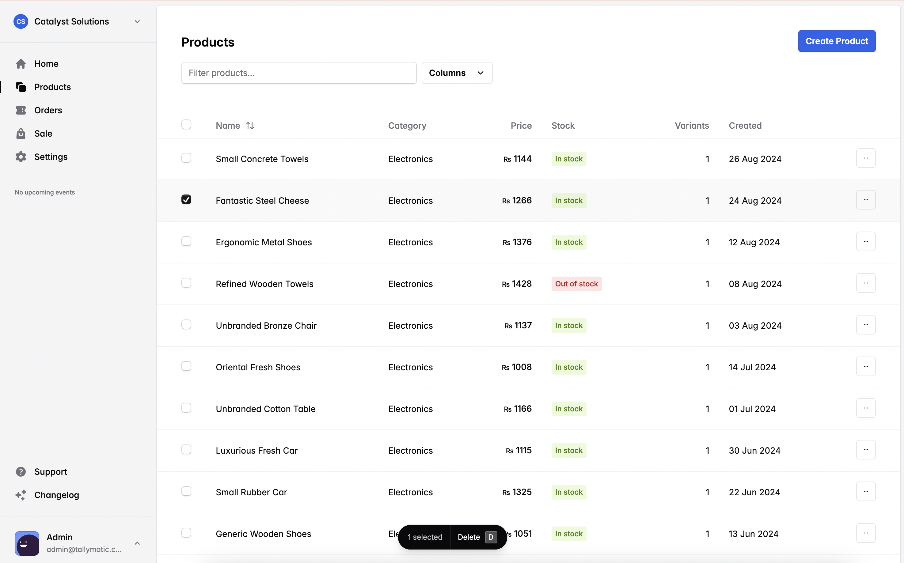

# Tallymatic - Point of Sale System

✨ **Tallymatic** is a modern Point of Sale (POS) system designed to streamline product management, sales, and purchases for businesses of all sizes.



## Key Features

- Product Management: Add, edit, and manage your product catalog
- Sales Processing: Easily create and process sales transactions
- Purchase Management: Track and manage product purchases
- Inventory Control: Real-time inventory tracking and management
- Reporting: Generate insightful reports on sales, purchases, and inventory

## Getting Started

### Prerequisites


- Node.js (v14 or later)
- npm (v6 or later)
- PostgreSQL (v12 or later)

### Setup

1. Clone the repository:

   ```
   git clone https://github.com/your-repo/tallymatic.git
   cd tallymatic
   ```

2. Install dependencies:

   ```
   yarn
   ```

3. Set up environment variables:

   - Copy `.env.example` to `.env` in the `apps/api` directory
   - Copy `.env.example` to `.env` in the `apps/web` directory
   - Update the `.env` file with your database credentials and other configuration

4. Set up the database:

Run `docker run --name drizzly -e POSTGRES_PASSWORD=password -e POSTGRES_DB=tallymatic -d -p 5433:5432 postgres` to start postgres container
   
```
yarn db:generate
yarn db:migrate
yarn db:seed 
```

🚧 In case db:seed fails run it twice

5. Set up redis

Run `docker run --name ioredisly -d -p 6379:6379 redis:latest redis-server`

We are using defaults so shouldn't cause a problem here

## Running the Projects

### Run All

To start all the projects within apps

```
yarn dev
```

### API (Backend)

To start the API server in development mode:

```
yarn dev:api
```

### Web Dashboard (Frontend)

To start client in development mode:

```
yarn dev:web
```

### Debugging Common Issues

#### Environment Variables in Turbo Repo

NOTE: whenever adding a new make sure to include it in the turbo.json so that it can be passed to process.env otherwise the enviroment variable will be `undefined`